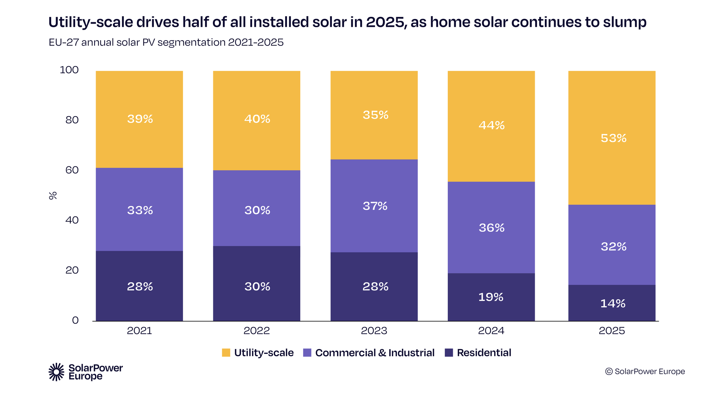
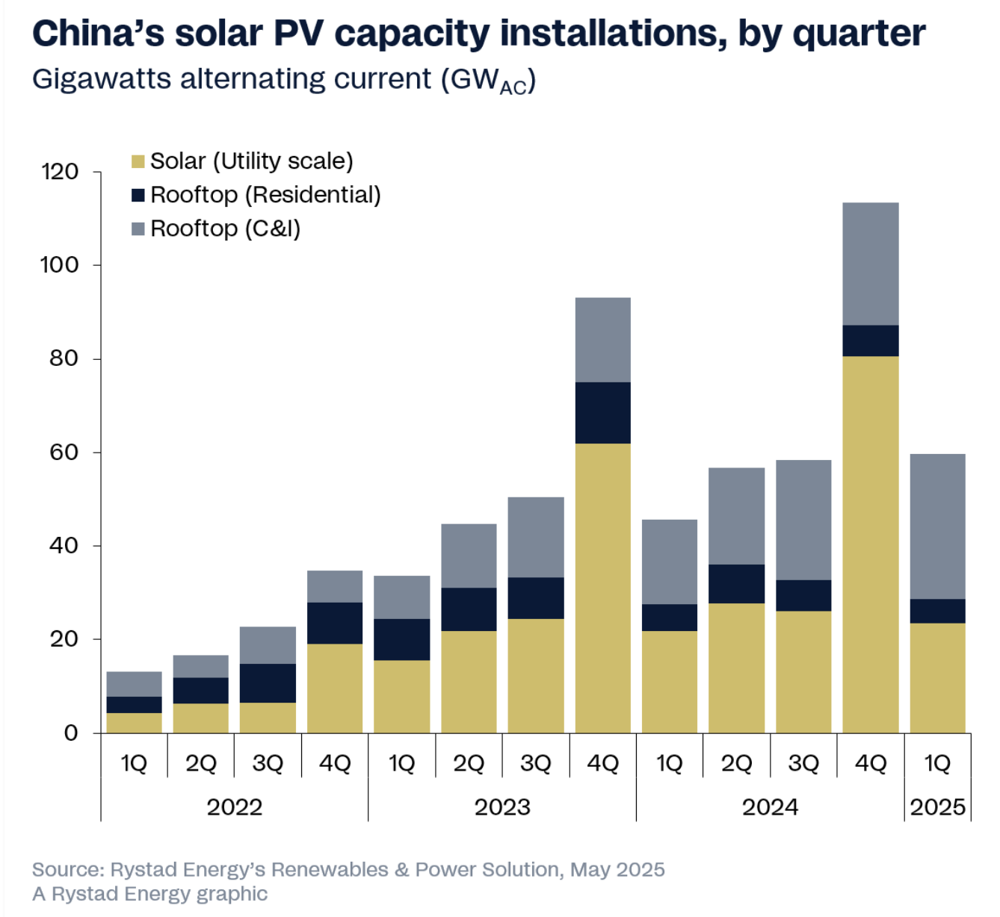

# We should automate rooftop solar installation

Abstract:
*Robots are beginning to help build utility-scale solar plants and maintain installed panels. Rooftop installation, especially on large commercial buildings, remains largely manual. Automating some of that work could help installers build faster and reduce the strain of work people do on roofs.*

*This essay examines the size of that opportunity and the practical challenges of building such a system, with a focus on hardware. Roofs vary widely, and a useful automated system would need to work safely and reliably across many sites. Advances in robotics and AI make this a good time to define those requirements and explore how such a system might be built.*

Note to readers:
*I hope this article yields feedback, especially from professionals in the solar, construction, and robotics industries. An additional hope is that it will spark more discussion on the concrete needs of the solar industry, and the necessity to work on the energy expansion. Finally, I hope it will inspire people to explore unexplored realms and invent what they want to see in the world.*

## Table of contents
{:.no_toc}

* TOC
{:toc}

## Solar PV has huge potential
*If you know about solar's learning curve, you can skip this section*

The world's energy needs are huge, whether that's replacing fossil fuels, powering the datacenter expansion, and existing applications are increasingly electric (most notably electric vehicles and heat pumps).

Solar PV has enormous potential, as a factory-produced energy production machine, that is almost infinitely scalable (both up and down). The most important element to understand is that its [learning curve](https://en.wikipedia.org/wiki/Experience_curve_effect) is [steeper than any other established energy technology](https://www.cmu.edu/epp/iecm/rubin/PDF%20files/2015/A%20review%20of%20learning%20rates%20for%20electricity%20supply%20technologies.pdf). [Swanson's law](https://en.wikipedia.org/wiki/Swanson's_law) is the observation that for decades, this learning curve showed a price drop of around 20% for each doubling in production. The case goes beyond past trends: the underlying economics suggest solar electricity could become [much cheaper still](https://unchartedterritories.tomaspueyo.com/p/can-solar-costs-keep-shrinking).

 Source: [Wikimedia](https://commons.wikimedia.org/wiki/File:1975_%E2%80%93_Price_of_solar_panels_as_a_function_of_cumulative_installed_capacity.svg)

This decrease in price means that solar will continue to become the cheapest source of energy in ever less sunny places. The geographical differences aren't actually huge to start with: between Denmark and Saudi Arabia, the difference in annual production for the same installed capacity (kWh/kWp) is only a factor of two (click somewhere on the map of the [Global Solar Atlas](https://globalsolaratlas.info/)).

In terms of practical usage, the daily intermittency and clouds makes batteries a necessity for sustained power, and seasonality (the six darkest months corresponding to about 1/4 of the annual production in central Europe) creates an incentive for seasonal energy storage (rather than huge overbuilds of solar capacity). These technologies exist or are being developed. Batteries are now [ten times cheaper](https://ourworldindata.org/battery-price-decline) than twenty years ago, have a steep learning curve of their own, and China is already being able to produce about twice the world's demand, with Europe, the US, and some Asian countries racing behind. Seasonal storage is a trickier problem, chiefly because it is generally used only once a year, forcing engineers to design the cheapest possible system to build, such as a heated up pile of [crushed rock](https://pubs.aip.org/aip/acp/article/2445/1/160006/2824369/100-Gigawatt-hour-crushed-rock-heat-storage-for), of [dirt](https://www.austinvernon.site/blog/standardthermal.html), or of [water](https://en.wikipedia.org/wiki/Aquifer_thermal_energy_storage).

## What limits solar's expansion
*If you are well-acquainted with the solar electricity market, you can skip this section*

### Grid constraints
The grid has become a bottleneck. First, connection queues [have reached record levels worldwide](https://www.iea.org/reports/electricity-2026/grids), stalling new generation. Getting new grid infrastructure from planning to running can take [from 5 to 15 years](https://www.iea.org/reports/electricity-grids-and-secure-energy-transitions/executive-summary), much longer than solar installations, which take 1 to 5 years. Also, it must be said, the variability of solar can pose a risk to grid stability without required upgrades (including batteries) and adaptations, with some observers [claiming that this variability contributed to the 2025 Iberian blackout](https://www.telos-eu.com/fr/economie/black-out-espagnol-la-transition-electrique-doit-e.html#_ednref3). There is a limit to how much solar can be added to the grid without upgrades, and accidents like blackouts make it politically less acceptable. Finally, it has been argued that soon, decentralised solar and battery systems/mini-grids [will be cheaper](https://caseyhandmer.wordpress.com/2020/12/27/the-future-of-electricity-is-local/) than large centralised grids across the world.

### Non-module costs
Besides grid constraints, solar PV's cost decreases are held back by two main factors:

#### 1. Network costs and levies
These include transport and distribution, as well as tax and fees on electricity consumed by the end-user. They now account for close to half of electricity costs today (except for the largest industrial users), whether in [Europe](https://ec.europa.eu/eurostat/databrowser/view/nrg_pc_206/default/table?lang=en) or the [US](https://www.eia.gov/todayinenergy/detail.php?id=55639).

On-premise solar eliminates the need for this infrastructure and avoids these costs. It replaces payments to the system with up-front investment or financing costs. With the drop in solar PV and battery prices, it is fast becoming advantageous everywhere. End-user owned solar is also predictable in cost, contrary to grid electricity, reducing risk for businesses.

#### 2. Installation and operation costs
Solar hardware (panels, inverters, as well and electrical and structural balance of system) is mass-produced and continuously refined, leading to rapidly decreasing costs. This has made the "soft" costs [the largest cost component of solar power plants](https://www.austinvernon.site/blog/solaronground.html). Any efforts to further the energy expansion will have to focus increasingly on reducing the cost of installation (labor, design & engineering, civil engineering, logistics), administration (taxes, permitting, developer costs, EPC overhead & margin), and operation (monitoring, repairs and replacement, cleaning, insurance, site upkeep, administration, security).

These costs can be tackled through simplification of designs and automation. Thus, for instance, in utility projects, [installing panels directly on the ground](https://www.austinvernon.site/blog/solaronground.html)) eliminates the need for steel racking, greatly simplifies the installation, and reduces maintenance costs (no grass grows under panels, and cleaning is simpler).

## Existing automation for solar PV
Robots are now used to clean panels, [inspect them](https://www.youtube.com/watch?v=yx2sUMyQ_wM), and [mow the grass](https://www.youtube.com/watch?v=xGKq6hKRGbU) underneath them. The final forms for these use cases remain to be found: see [for instance](https://www.youtube.com/watch?v=USu2fmQlocg) the [different](https://www.youtube.com/watch?v=NSnzzze9YNw) existing [cleaning robots.](https://www.youtube.com/watch?v=WlkYRmbLQrw) 

They are also used to install them in fields, with [several](https://roboticsandautomationnews.com/2026/08/10/interview-with-maximos-nick-hegeman-180000-robotic-installations-of-solar-panels-and-counting/104039/) [companies](https://cleantechnica.com/2025/10/06/ai-powered-robots-install-solar-panels-faster-than-any-humans/) now deploying [pile-driving](https://www.youtube.com/watch?v=CiIRiT7UrdA) and panel-placing robots. Some companies push automation even further with [an on-site assembly line pre-assembling panels](https://chargerobotics.com/).

 *An on-site pre-assembly line – Source: Charge Robotics*

Rooftops, commonly divided into residential and commercial, remain close to half of solar additions across the world besides utility (mostly large fields). Due to the complexity of the terrain however, they have not seen much automation in installation, with two exceptions.

The first is a [roofing robot installing shingles](https://www.youtube.com/shorts/Q_hdhJG2rGg), developed by Renovate Robotics, which is made for residential steep-sloped roofs and designed for solar installation as well, capable of handling both solar shingles and rack-and-panel solar systems. Cables anchored at multiple points guide the robot across the roof, while computer vision helps it position each shingle.

*Renovate Robotics's shingle installation roofing robot – Source: Renovate Robotics*

The second is a [rail-mounted robot installing arrays of panels on large roofs](https://solar-d.co.th/news/Solard-Robot-LightSpeed-%E0%B9%81%E0%B8%9C%E0%B8%87%E0%B9%82%E0%B8%8B%E0%B8%A5%E0%B8%B2%E0%B8%A3%E0%B9%8C%E0%B9%80%E0%B8%8B%E0%B8%A5%E0%B8%A5%E0%B9%8C-%E0%B9%82%E0%B8%8B%E0%B8%A5%E0%B8%B2%E0%B8%A3%E0%B9%8C%E0%B8%84%E0%B8%A3%E0%B8%9A%E0%B8%A7%E0%B8%87%E0%B8%88%E0%B8%A3), developed by Solar D, which works as follows. First, multiple solar panels are pre-assembled together in a factory and transported to the construction site. Second, workers install rails on the rooftop surface. Third, a crane lifts a panel from the ground and positions it on a rail-bound installation robot at the edge of the building. Finally, the rail robot brings the panel to its final position on the roof, unloads it, and returns to the edge of the roof to fetch the next panel. The company, itself a solar installer, claims it sped up deployment of 1 MW (1600 large 650) from 60 days to 6 days, while reducing the number of workers by half and reducing the risk of damage to the roof. So partial automation, with the fine-grained manipulation tasks such as fixing rails to the roof still done by humans, while the backbreaking tasks such as moving the panels are handled by machines. The company made [a great video](https://lnkd.in/p/eFKtmw9Y) that shows the system in action from up close. One drawback of the system is that it cannot be deployed on roofs with a significant number of obstacles, and that it needs a crane, meaning a crane operator.

 *A crane and rail semi-autonomous panel mounting system – Source: Solar D (translated from Thai)*

## Why automate rooftop installation ?
As hinted at previously, energy expansion is an emergency, whether from an economic, environmental, or sovereignty perspective. Technologies that can accelerate it substantially by lowering costs and scaling deployment should be explored.

Therefore I took an interest in automation of flat rooftop solar installation, with a focus on commercial rooftops. Why this focus ? Because more people need to be working on scaling this, because the variety of roofs seems to call for multiple approaches, especially in terms of navigation/positioning of panels, and because large roofs seem amenable to automation, given a higher proportion of repetitive steps. Another reason is businesses' high sensitivity to energy prices, and again, the fact that very few people are working on an evidently crucial automation market.

A rooftop solar installation robot could both speed up PV deployment and reduce dangerous, strenuous work on hot roofs, potentially lowering injuries and improving worker retention. It would allow solar installers to make the most out of a limited pool of workers in an era of aging societies and increasing labour shortages, especially in construction.

Buildings are 30-40% of final energy consumption. It makes sense to locate energy production on-site where possible, avoiding T&D costs, as well as various taxes and fees. Further, businesses tend to be enticed by the possibility of owning part or totality of their electricity supply. As said previously, the demand will persist, not only due to mandates, but also due to the economic pain wrought by high energy prices in various markets. And obviously, even thriving businesses would benefit from lower energy prices.

## The market opportunity
As a European hoping to help revive the region’s industry, I focused first on its market. The technology could also be exported or developed elsewhere in parallel.

### The current rooftop PV business
While the theoretical potential of residential PV is twice as large, the market size of commercial installation is now larger, likely due to businesses' higher sensitivity to energy prices, longer investment horizons, easier permitting, etc. The EU installed about 20 GW/year of commercial and industrial rooftop solar in the last few years, bringing cumulative capacity in that segment to roughly 158 GW.

In China, which is by far the world leader in solar deployment (around four times the pace of the EU), commercial rooftop installations (C&I) now far surpass residential, although the gap is [predicted](https://www.rystadenergy.com/news/china-rooftop-solar-installations-hit-record-in-1q25) to decrease.

Adding slightly smaller roofs, those with a surface of >1000m2, from both residential and non-residential categories, and the estimation goes up to 800 GW.

### The potential value of automation

Separately, a [building-level study](https://joint-research-centre.ec.europa.eu/jrc-news-and-updates/rooftop-solar-could-meet-40-eus-long-term-electricity-demand-2026-01-21_en) estimates 355 GW of technical rooftop potential on non-residential buildings with roof areas above 2,000 m². That figure does not tell us how many roofs are flat, although the study [asserts](https://www.nature.com/articles/s41560-025-01947-x) that most non-residential buildings have flat roofs. These researchers are also [working](https://op.europa.eu/en/publication-detail/-/publication/d418ba32-473e-11f0-85ba-01aa75ed71a1/language-en) on a more detailed database regarding the types of roofs used in EU buildings (i.e. flat, pitched, or green roofs). Of note: what constitutes a "flat" roof is quite ill-defined and varies by country (even within countries depending on the domain: roofer security, waterproofing, ...).

Let's do some napkin math to verify the scale. Suppose that all the 158 GW of installed commercial and industrial projects took place on rooftops larger within than 2,000 m²; this would imply about 200 GW of potential. At the current median cost of ~1 billion EUR/GW, with labour costs at 15%, and if we suppose also that two-thirds of these roofs are flat, we need 20 billion EUR worth of labor to install solar on all large, flat non-residential rooftops.

Now let's think of the global scale: quite conservatively, the unused large rooftop surface should be about the same size in the US, double in China, and another "Europe" for the rest of the world. That would correspond to an additional 800 GW expansion to address, or 80 billion EUR of labor.

 For a robotics business, this is more than big enough of a market to tackle, even if we cannot automate all of it.
 
## How automation would work
We want a standardised solution on not-so-standardised roofs. The possibilities in terms of panel disposition, installation robot, mounting structure, etc. are very extensive. Let's think about what the task requires, and a few possible approaches. The guiding principles should be safety, simplicity and reduction of variability in operation to the strictest minimum (hence of AI). Safety truly is paramount, because accidents will be even more scrutinised than in human-operated systems, and adverse events (roof damage, injuries) could threaten the project's viability. Simplicity makes things easier to automate, and cheaper altogether. Less variable means less reliance on AI systems (neural nets) that make errors and hard to interpret. Additionally, an ideal long term goal would be to avoid the need for any human on the roof; verification and possible adjustments could be tele-operated remotely using the installation robot.

### Getting panels on the roof
Whatever the mounts we use to keep the panels on the roof (ballasted, screwed, or bonded), we need to get the panels up there in the first place. Here, the typical use of ladder hoists seems like the right approach. They are modular, adapting to different building sizes, and most importantly can be part of an automated chain. The idea is, once the system installed in-situ, it works like a factory line with as little human intervention as possible: the rooftop modules (panels + mounts) are autonomously assembled on the ground, charged onto the ladder hoist, elevated to the roof, discharged to the installation robot, placed at their intended roof spot, and then wired together (the last part likely done by humans).

Cranes, often used in larger projects, could be automated, but it would be more complicated than a lift due to the added degrees of freedom, and the risk of collision with the building, vehicles or people. They also take up a lot of space and requires licenses to operate, making them a secondary choice for automation in this context. 

Another possible idea is to use assembly lines and cargo drones, which could both lift modules to the roof and position them at their final location. Heavy-lift cargo drones carrying multiple times their weight are now possible, as the US DARPA Lift Challenge [recently demonstrated](https://www.darpaliftchallenge.com/results), so this might seem appealing. However, this system, despite its few ostensible parts, would need a custom platform for loading, take-off and landing, and a live battery replacement system to enable daylong missions. One would likely need to design a custom cargo drone and its controls, including for its wind-susceptible cargo. Retrofitting existing heavy-lift drones would mean buying (very) expensive machines. Secure flight authorisation and licenses for automated drones carrying heavy weights are also likely to be a barrier, especially if we want to address various markets. Further, a cargo drone would pose higher risks than a ladder hoist to the building structure. All these tasks seem more difficult and complex than using a ladder hoist combined with a wheeled or possibly legged robot, both of which are more stable platforms for autonomous navigation.

### Positioning panels on the roof
A wheeled vehicle seems like the simplest system for flat roofs, however the presence of obstacles might be an argument for legged locomotion. In the industrial maintenance inspection field, for instance, quadruped robots are becoming standard. They could avoid some obstacles and potentially place panels in areas unaccessible to a wheeled robot. Hexapods could be appropriate [for inspections on steep roofs](https://ascelibrary.org/doi/epdf/10.1061/AOMJAH.AOENG-0088?__cf_chl_f_tk=2zHUI7Wj3uIPPQXWq5VSo1ifREvNiZkJMolNAzFw.nQ-1791938132-1.0.1.1-zivQP79f9p4soT3w97whVoI0STZk.B3u2MTq0Gc6KOs), but they are more complex and not necessarily needed for flat surfaces.

Whatever its embodiment, the robot should hold panels horizontally rather than vertically during transport, to avoid turning them into a sail. Unless small panels are used or a quite large wheeled robot, the dimensions of the vehicle should therefore occupy less space than its cargo. Hence, it is more likely to be panel size than vehicle size that constrains navigation on the roof. Panels might also be rotated to vertical position to go through certain narrow passages on the roof, but this only makes navigation more complicated. More information about the various roof geometries and existing installation practices should inform us.

When the robot arrives in front of the desired position to deposit an assembled, ballasted module, it needs to both unload the module, and position the module in its final corner of the building. Simply inclining a carrying platform to make the item slide down would not be advisable, given the risk of scratching/scrape of the roof when doing so.

For cleaning purposes, it would make sense to make the panels one continuous surface, so that contiguous panel areas on the roof can be cleaned in one go with another specialised [robot](https://www.youtube.com/watch?v=OYFL1TDE3N8). But this for now is a secondary issue.

We want to assemble elements on the ground, following the Charge Robotics/Terabase Energy model. This task can be automated using classical methods, i.e. in clear, no AI is involved in manipulation itself, so no deep learning for control, only perception. This leads to a tradeoff: the more we assemble on the ground, the less the robot needs to do on the roof, but also, the more weight and volume the robot needs to handle, making it more difficult for it to navigate on the roof. For ballasted systems, which are the simplest to install on a roof (no roof penetration and sealing needed) the assembled weight of just a few modules (panels + ballast) could reach into the hundreds of kg.

*A preassembled array of panels being driven to its field position on a solar farm – Source: [Terabase Energy](https://www.youtube.com/watch?v=oj2zdQYXGNE&t=1m58s)*

Safety being a key priority of our system, we want to prevent it from:
- falling off the roof
- dropping panels off the roof
- damaging a roof element
- damaging itself

 Hardware safeties such as a [brake motor](https://equipmake.com/knowledge-base/understanding-brake-motors/) that stops the wheels in case of power loss would provide some guarantees. If workers must be on the roof and thus secure the roof against falls, the barriers could be adapted to prevent robot falls. We could also make the edges of the roof mechanically off-limits to the robot by anchoring it to some point with a tether, but this would require a moveable anchor, adding complexity and likely human labor on the roof.

### Securing panels on the roof

#### Ballasted mounts

Ballasted mounts, where the solar rack is held to the roof using weight (typically concrete bricks) would be ideal. It avoids lengthy and risky on-roof tasks such as penetrating the roof and weatherproofing it. The robot only has to navigate with the module to the right point, and then place the modules in their intended position. No on-roof assembly, screwing, etc.

Ballasts [that serve as the whole mounting structure](https://www.sunballast.com/structure-for-flat-roofs/), with no rail, are a good simplification idea. If possible, panels should be mounted on them autonomously on the ground, not by humans or a robot on the roof.

Ballast have problems: some roofs are too weak for them, the roof needs to be very flat (<5 degrees), and they have less wind resistance than penetrative systems. Optimising for weight and wind resistance with [lighter panels](https://www.longi.com/en/news/hi-mo-x10-light-design-launch/) and aerodynamic design might help, but a one-size-fits-all solution is hard given that each roof is different. Also, they might require a structural engineer's assessment depending on the jurisdiction, which adds a potential bottleneck to the project and some cost.

The protective sheets or mats that protect the roof from the ballast should be joined to the ballasted part during the pre-assembly place, or even manufactured into the ballasted parts, to cut down an installation step.

If custom ballasts are designed, they could be open-sourced to help widen distribution of the robot, following the idea of [commoditising a product's complement](https://gwern.net/complement).

#### Glued panels

##### Flexible panels
Gluing flexible, rolled-up solar panels to roofs (and facades !) would be very interesting, greatly simplifying the installation process and eliminating the need for mounting structures. A robot would simply have to navigate to installation spots, and then press a roll down on its path. However, flexible, thin-film PV technologies are more expensive than silicon PV, significantly less efficient, and their durability is less proven. They might be the approach to scale for roofs which are too weak for all types of silicon PV panels: according to Power Roll, a startup developing a solar film using perovskites, this could concern 30% of commercial roofs. Flexible modules in general seem [very promising for facades](https://www.youtube.com/watch?v=-7ePRY7zDb8): no scaffolding, lift or crane needed to install them, just a robot dangling down from the roof or crawling/rolling up. Vertical panels produce significantly more in cold months (in high-latitudes regions) than flat or inclined panels, due to more horizontal winter sun rays, while producing less on a yearly average. Finally, some flexible panels such as Power Roll's can potentially be produced using [roll-to-roll manufacturing](https://en.wikipedia.org/wiki/Roll-to-roll_processing), which is very cheap and extremely scalable. But from our research, none of these technologies are mature or cost-effective for our desired use case.

##### Rigid panels
Gluing classic, rigid silicon PV panels to the roof with various adhesives, also known as mounting via bonding, doesn't seem like much of a solution either, since most panels aren't made for it, and it permanently alters the roof surface, making it difficult to repair, or replace a panel. For some roofs, it is recommended not to bond the panels directly on the surface, but on an additional sacrificial membrane layer that is heat-welded to the primary roof membrane, adding an extra part and step to the process. That module manufacturers do not rate their panels as adhesive-ready doesn't necessarily disqualify them: it might mean too little testing was done to make guarantees about this installation method. Importantly, a module that cannot be removed from the roof without risk of damaging it, for roof repair, module replacement, etc. can become a liability. One data point that could move the needle on this issue is the actual longevity of solar panels, which could go beyond 40 years if the panels are good quality. However, due to lack of field data, long-lifetime PV panels aren't proven yet, and businesses would for now want to avoid possible dead panels. In summary, it poses problems in terms of serviceability and roof integrity, although there might be roofs for which the simplicity of installation and lower cost are an acceptable tradeoff.

#### Penetrative mounts
We'd like to avoid them, mainly for two reasons:
1) It involves heavy duty (by today's standards) robotic manipulation skills (or lengthy human labor). 
2) The consequences of an error are too big: if the robot properly drills a hole in the roof to place mounts for a solar panel, but then it doesn't properly weatherproof that hole, the roof might be damaged. 

#### Clamping mounts
These don't really apply to the typical membrane roof of large commercial and industrial buildings, more to corrugated metal roofs.

### Panel layout
Here again, simplicity comes first, followed by maximisation of the usage of the roof area, followed by maximisation of yield of each panel. For instance, a simpler panel layout could potentially reduce installation costs by more than the value of the electricity it would forgo compared with a layout designed to maximise production per panel. Research has been [conducted](https://www.aramis.admin.ch/Texte/?ProjectID=49455) on how to dispose panels on rooftops to produce more per unit of roof surface, but we won't discuss this here. Choosing the ideal inclination, using trackers, reflectors, and other methods to maximise output per panel have been amply studied. It seems hard to properly model the space of possibilities for panel layout, given its consequences on the robot design, but we should try to do it as systematically as possible.

### Wiring
Unless it is our key value add, it doesn't seem worth it to try to automate this in our setting, since physical AI hasn't made this systematically feasible and reliable for now (that we know of). Given that we are designing installation hardware, it would more sense to perform as much pre-assembly as possible, could remove much of the module-by-module wiring 
. we should be wary of relying on AI when we can (mostly) eliminate the step using a different hardware design. On the other hand, one could argue that one should already integrate physical AI models in systems to prepare for soon-to-come more powerful models. If navigation is mastered, we could start testing various approaches to wiring using a robotic arm, and measure success rate. Even if reliability is not 100%, as long as no hardware is damaged by the wiring rebot, it's data collection for your futur robotics-model finetuning. 

Parallel to exploration of physical AI "base models", one should try to simplify manipulation tasks using hardware design that reduces variability (e.g. design systems which are "easy-to-wire"). For instance, given that learned physical manipulation skills are still far from 99.99% reliability, or 96% reliable, we might need to teleoperate for some time, both to finish the job from the ground, and to collect data to train a more reliable AI policy on the task. Of note: progress in physical AI should be huge in the next 2-5 years, so the preceding paragraph might be off base, and we might have extremely reliable AI models for physical manipulation that perform tasks better than humans soon. Although we should be open to this possibility, I don't believe we should count on it at this stage. Additionally, a simplified hardware design makes things easier and faster for human installers.

### Automation approach
In this section I will focus on general considerations for automation itself.

#### System variability must be minimised
AI, which today means neural networks and systems built on them, enables the handling of variability by autonomous systems. The main variability we face is that of buildings' structure itself, and weather conditions. There might be some workers on the roof while the robot is operating, but ideally none, to remove another source of variability, and also reduce roofing risks. In general, it is important to minimise system variability, also because it limits the need for error-prone and hard-to-audit AI systems. This is because construction is a domain where errors can cause very expensive physical damage or time loss, an AI cannot repair physical damage, unlike software.

#### Relevant autonomous systems
In the area of roof robots, very few autonomous systems exist, and none seems to be mature, despite the size of the roofing industry and its high contribution to construction accidents. So most of the domain knowledge here needs to be invented. Obviously, self-driving would be the main source of learnings, followed by autonomous construction robots (mining vehicles, excavators, ...). The data and practical learnings from human-operated roof inspection drones could also be useful.

#### Mapping and navigation
Safety cannot be purely hardware-based nor deterministic, given that the robot needs to work autonomously on varied terrain.

Before module placement, the roof would need to be mapped precisely, the important elements being:
- roof edges
- roof openings
- fragile zones that can't sustain the robot's weight
- obstacles

Use of a drone for mapping could be useful, but adds another component to the bill of materials and implies certain skills which are not a widespread. It is simpler to use a single robot both for mapping, and for installation. Mapping is needed in all cases to know where to place modules.

### Business model
The more we integrate the business by designing custom hardware, such as ballast mounts or wiring systems, the more it might be difficult to sell the system to existing solar installers. On the other hand, vertical integration might be necessary for automation in the sector, barring enormous progress in physical AI (which is not out of question but cannot be relied on at this point in time).

The solar panels don't need to be designed; the industry produces enough of them at enough standard sizes that installers should be left with the choice of panels, while the mounting structure would be sold with the robot. Recurring revenue from mounting structure sales would add to the business case for the company manufacturing the automation system, but installer acceptability should always be taken into account, as installers would be the main (only?) clients of our putative rooftop installation automation company. 

The automated system would likely require its own planning software, which could be somewhat of a barrier to adoption by installers, although it is an obvious necessity, since existing software only works with human installers.

The robot manufacturer could also become an installer, but the size, fragmented nature, and complexity of the world's PV installation markets strongly encourage selling a system to existing installers.

### Why not use humanoids ?
Humanoids are being built by many companies, but it is hard to gauge timelines for general-purpose physical AI that could put them to work efficiently and safely on varied tasks, especially construction, which is a much more chaotic environment than a factory or logistics centre, with a smaller margin for error. Even if humanoids end up being adequate for the task in 5 years and cheaper than a purpose-built robot, the work of designing and building an automated rooftop installation system would have been useful. With humanoids too, we need to define system requirements, possible benchmarks and metrics, collect field data, integrate with industry, and manage human-robot interaction. Current physical AI models tend to be functional on various embodiments: if this versatility persists in next generations, we should be able to transfer a lot of the learnings to the best-adapted embodiment.

### The main challenges
- On-roof navigation, i.e. self-driving on a dangerous and fragile construction site
- Reliable automated wiring (maybe this could happen further down the line)
- System design: a safe and versatile autonomous system that works well on a large proportion of flat rooftops, and can be scaled both in deployment and in manufacturing
- Integrating with the existing rooftop installer sector

### Questions to clarify in priority
- More information about roofs:
	- distribution of flat roofs
	- distribution of metal and membrane roofs
	- what constitutes a navigable roof for different robotic platforms ? 
- General tradeoffs of mounting systems

Thanks to: Casey Handmer and Austin Vernon, for having written such great blogs on energy, economics and technology
